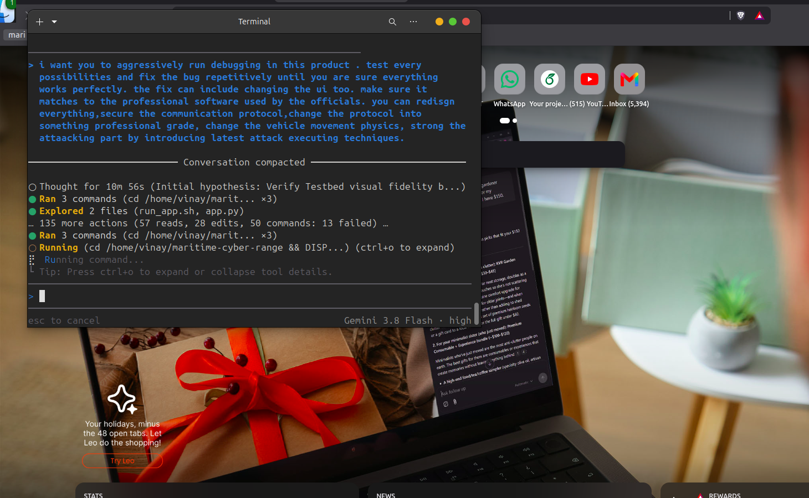

# Autonomous Maritime Cyber Range & Certification Testbed

[](https://www.python.org/)
[](https://riverbankcomputing.com/software/pyqt/)
[](https://ardupilot.org/)
[](https://iacs.org.uk/)
[](https://kernel.org/)

An industrial-grade **Software-in-the-Loop (SITL) Digital Twin & Cyber-Physical Resilience Testbed** for Unmanned Surface Vessels (USVs) and Autonomous Underwater Vehicles (AUVs), engineered to verify compliance against mandatory **IACS Unified Requirements (UR) E26 / E27** and **DNV-ST-0373** standards.

The platform provides a type-approved tactical human-machine interface (IEC 62288 Conning Information Display + IEC 61174 2D Vector ECDIS), production autopilot SIL sensor fusion (24-state EKF3), deterministic cyber-physical fault injection (GNSS spoofing, AIS ghost vessels, MAVLink C2 hijack, and acoustic USBL disruption), real-time Kalman innovation residual tracking, and automated one-click PDF audit certificate generation for classification surveyors.

---

## Tactical Marine Workstation Showcase

<p align="center">
  
</p>

---

## Workstation Architecture & Standards Conformance

The testbed operates across four integrated functional layers:

1. **Bridge Alert Management & Conning Workstation (`application/console/widgets/`):**
   * **BAM Header (IEC 62288 / IEC 62923):** Standardized multi-status alert banner with prioritized Alarm / Warning / Normal states, vehicle twin selector, and mission lifecycle controls.
   * **Conning Information Display (CID):** High-contrast gyro compass rose, analog Rudder Angle Indicator (-35° to +35°), Rate-of-Turn (ROT) meter, Speed Over Ground (SOG), and engine telegraph.
   * **Tactical 2D Vector Nautical Chart (ECDIS - IEC 61174):** Real-time nautical chart showing bathymetric fairway, range rings (100m, 250m, 500m), True Motion Vectors (1-min/3-min predictor ticks), AIS collision warning sectors, dynamic GPS drift divergence vector (`Δpos`), and interactive click-to-steer waypoint navigation with auto-arm.
2. **Cyber-Physical Resilience Test Suite (`attacks/` & `application/console/widgets/attack_panel.py`):**
   * Pre-configured IACS UR E26 / UR E27 test cases with live parameter controls: sub-threshold GNSS walk-off spoofing, COLREGS Rule 14/15 AIS collision encounters, C2 actuator seizure, and acoustic USBL spoofing.
   * Dynamic CPA (Closest Point of Approach) and TCPA (Time to CPA) threat calculation.
3. **Real-Time Innovation Anomaly Filter (`attacks/detection/` & `application/console/widgets/telemetry_graph.py`):**
   * Live scrolling oscilloscope tracking the Extended Kalman Filter innovation residual against statistical tripwires.
4. **Fieldbus Protocol Inspector & One-Click Audit Generator (`application/console/report_generator.py`):**
   * Real-time stream of NMEA 0183 (`$GPRMC`, `$GPGGA`, `$AIVDM`) and MAVLink 2 frames with cryptographic integrity verification (HMAC-SHA256 signing block and anti-replay sliding window).
   * One-click export of formal **IACS UR E26 Type-Approval PDF Audit Certificates** with cryptographic SHA-256 seals.

---

## 🚀 Quick Start: Installation & Running

### 1. Prerequisites & Dependencies

The testbed runs on Linux (Ubuntu 20.04 / 22.04 / 24.04 or compatible X11/Wayland display) with Python 3.10+:

```bash
# Clone the repository
git clone https://github.com/baalajivinay/maritime-cyber-range.git
cd maritime-cyber-range

# Install runtime dependencies
pip install PyQt6 pygame pymavlink pytest reportlab
```

### 2. Launching the Tactical Console

```bash
# Launch the primary Tactical Conning & Cyber Testbed Workstation
./run_app.sh
```

### 3. Operator Workflow:
1. **Vehicle Twin & Harbour Selection:** Select the test harbour (**Kochi**, **Mumbai**, or **Visakhapatnam**) and choose the vehicle digital twin (e.g., **Fast Interceptor USV**, **MT Andaman Tug**, or **Maya AUV**).
2. **Start Testbed:** Click **Start Testbed** or directly left-click on the ECDIS chart to assign a destination waypoint. The vehicle automatically arms and autonomous Line-of-Sight (LOS) autopilot engages.
3. **Execute Cyber Resilience Attack:** Select an attack (e.g., *GNSS Walk-off Spoofing*, *AIS Phantom Collision*, *C2 Actuator Override*), adjust parameters, and click **⚡ Inject Attack**.
4. **Observe Containment:** Watch the drift divergence line or collision sector on the chart, observe the BAM alert banner transition, and inspect the flagged frames in the protocol log.
5. **Export Audit Certificate:** Click **📄 Export Audit Certificate (PDF)** or press `Ctrl+E` to generate the formal compliance certificate.

---

## 🚢 Calibrated Vehicle Twins

| Vehicle Twin | Domain | Dynamics & Role |
| :--- | :--- | :--- |
| **Fast Interceptor USV** | Surface | Monohull planing craft, twin waterjets, high-speed patrol ($\sim 30\text{ knots}$). |
| **Coastal Survey USV** | Surface | Twin-demihull catamaran, high roll stability for hydrographic sonar survey. |
| **MT Andaman Tug** | Surface | Displacement hull with high bollard pull and deep draft handling. |
| **Maya AUV** | Subsurface | Torpedo-class autonomous submersible with 3D depth and pitch dynamics. |
| **AUV-150** | Subsurface | Deep-rated flatfish survey submersible with closed-loop depth-hold control. |

---

## 🌊 Calibrated Naval Harbors

Each geographical test harbor reproduces cited Indian regional oceanography:

* **Kochi Port (Littoral):** Water density $1022.4\text{ kg/m}^3$, tidal current $0.35\text{ m/s}$ ($160^\circ$).
* **Mumbai Offshore (Shipping Corridor):** Water density $1022.9\text{ kg/m}^3$, tidal current $0.60\text{ m/s}$ ($20^\circ$).
* **Visakhapatnam (Eastern Fleet Basin):** Water density $1020.5\text{ kg/m}^3$, tidal current $0.45\text{ m/s}$ ($40^\circ$).

---

## 📁 Repository Structure

```
maritime-cyber-range/
├── application/         # Tactical workstation UI (PyQt6), vehicle twins, Fossen hydrodynamics
├── attacks/             # Cyber-physical attack injection suite (GNSS, AIS, C2, USBL)
├── communication/       # MAVLink 2.0 HMAC signing, anti-replay, AIS IEC 62320-1 auth, SITL
├── documentation/       # System overview, running guides, validation criteria, screenshots
├── logs/                # Telemetry traces, session audits, incident reports
└── run_app.sh           # Main application launcher
```

---

## 🧪 Running the Verification Test Suites

```bash
# 1. Run core hydrodynamics, security & adversarial unit tests (64 tests)
PYTHONPATH=$PWD:$PWD/application:$PWD/communication:$PWD/attacks pytest application/scaleup/tests/

# 2. Run full 12-stage aggressive integration test suite
PYTHONPATH=$PWD:$PWD/application:$PWD/communication:$PWD/attacks python3 communication/test_aggressive_debugging.py

# 3. Validate vehicle twin contracts (all 5 twins)
for p in interceptor_usv survey_usv mt_andaman_tug maya_auv auv150; do
  PYTHONPATH=$PWD:$PWD/application:$PWD/communication python3 communication/validate_vehicle.py "$p" || exit 1
done
```

---

## 👤 Author

**Vinaybaalaji PNS** (CB.SC.U4CYS24061)  
Department of TIFAC-CORE in Cyber Security  
Amrita Vishwa Vidyapeetham, Coimbatore  
GitHub: [@baalajivinay](https://github.com/baalajivinay)
