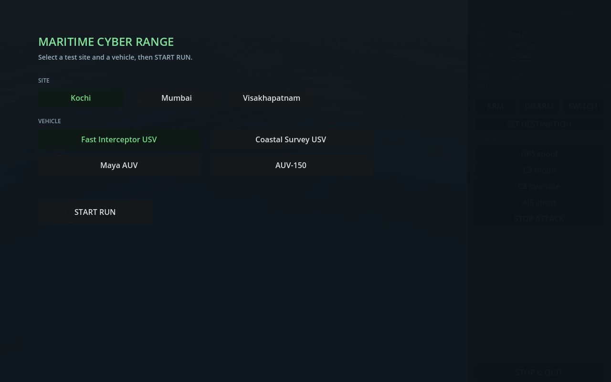
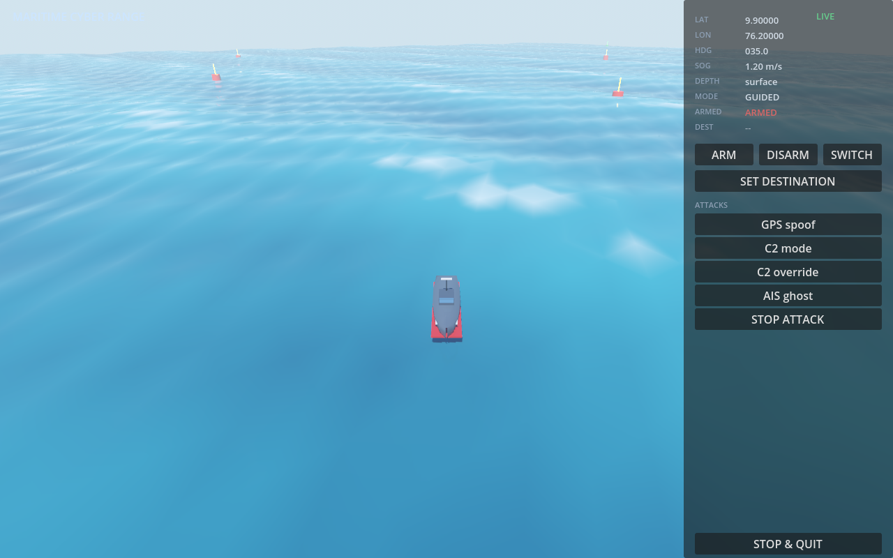
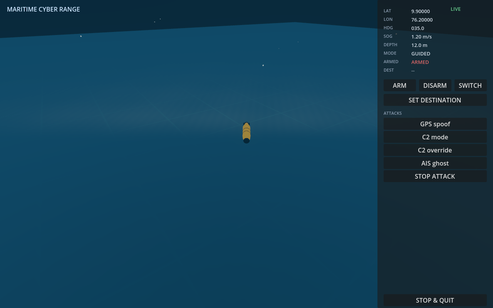
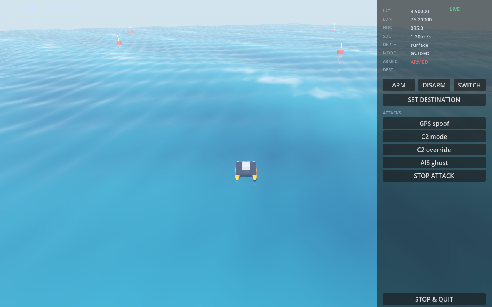
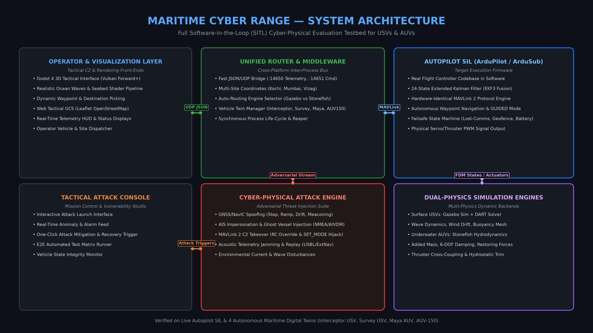

# Autonomous Maritime Cyber Range

[](https://www.python.org/)
[](https://godotengine.org/)
[](https://ardupilot.org/)
[](https://gazebosim.org/)
[](https://github.com/patrykcieslak/stonefish)
[](https://kernel.org/)

An open-source **Software-in-the-Loop (SITL) Digital Twin & Cyber-Physical Resilience Testbed** for Unmanned Surface Vessels (USVs) and Autonomous Underwater Vehicles (AUVs). 

Production autopilot firmware (**ArduPilot Rover** and **ArduSub**) runs alongside high-fidelity multi-engine physics (**Gazebo DART** for surface hydrodynamics and **Stonefish** for 6-DOF underwater added mass and damping). The platform visualizes missions in a real-time **Godot 4 Vulkan 3D front-end** and evaluates navigation stability against active cyber-physical attack injections (GNSS spoofing, AIS ghost vessels, MAVLink C2 hijack, and acoustic telemetry disruption).

---

## 3D Application Showcase

<p align="center">
  
  
</p>

<p align="center">
  
  
</p>

---

## System Architecture

The testbed operates across six decoupled layers bridged by non-blocking UDP/JSON messaging:

<p align="center">
  
</p>

1. **Operator 3D Front-End (`godot_app/`):** Built on Godot 4 (Vulkan Forward+), rendering dynamic water shaders, sun glint, procedural seabed bathymetry, marine snow particulate effects, and live telemetry HUD.
2. **Unified Routing Bus (`tools/godot_relay.py`):** Speaks JSON over UDP (`:14650` for telemetry, `:14651` for operator commands) with automatic sub-millisecond process lifecycle management.
3. **Cyber-Physical Attack Suite (`attacks/`):** Injects GNSS pseudorange walk-off, AIS phantom vessel broadcasts, MAVLink C2 channel overrides, and acoustic USBL positioning shifts.
4. **Autopilot SIL Core:** True production ArduPilot / ArduSub binaries executing real 24-state Extended Kalman Filter (EKF3) sensor fusion.
5. **Dual Multi-Physics Engines:**
   - **Surface USVs:** Gazebo Sim with DART physics solver, surface wave drag, and buoyancy tensors.
   - **Subsurface AUVs:** Stonefish C++ hydrodynamics calculating 6-DOF added mass, cross-flow drag, and restoring buoyancy moments.
6. **Real-Time Anomaly Detection (`detection/`):** Continuous innovation filtering using Page's Two-Sided CUSUM and kinematic consistency checking.

---

## 🚀 Quick Start: Running the 3D App

### Prerequisites
* **Operating System:** Ubuntu 22.04 / 24.04 LTS (x86_64)
* **Graphics:** Vulkan-capable GPU (NVIDIA discrete GPU recommended)
* **Engine:** Godot 4.3 binary located at `$HOME/godot/Godot_v4.3-stable_linux.x86_64` (or set `GODOT=/path/to/binary`)

### Launching the Application

Run the unified launcher:

```bash
# Launch the Godot 3D front-end and auto-routed physics backend
tools/app.sh
```

### Controls & Operator Workflow:
1. **Mission Setup:** Select a test harbor (**Kochi**, **Mumbai**, or **Visakhapatnam**) and pick a vehicle digital twin.
2. **Start Mission:** Click **START RUN**. The application boots the SITL autopilot and initializes the 3D ocean environment.
3. **Waypoint Navigation:** Left-click on the water surface to assign dynamic destination waypoints.
4. **Attack Injection:** Trigger live cyber attacks from the on-screen console (GPS Spoof, AIS Spoof, C2 Override, Acoustic Spoof).
5. **Observe Failsafes:** Watch the autopilot's Kalman filter react, detect anomalies, or diverge in real time.

To shut down all background simulation processes cleanly:
```bash
tools/teardown_all.sh
```

---

## 🚢 Calibrated Vehicle Twins

| Vehicle Twin | Domain | Physics Engine | Dynamics & Role |
| :--- | :--- | :--- | :--- |
| **Fast Interceptor USV** | Surface | Gazebo DART | Monohull planing craft, twin waterjets, high-speed patrol ($\sim 30\text{ knots}$). |
| **Coastal Survey USV** | Surface | Gazebo DART | Twin-demihull catamaran, high roll stability for hydrographic sonar survey. |
| **Maya AUV** | Subsurface | Stonefish | Torpedo-class autonomous submersible with 3D waypoint following. |
| **AUV-150** | Subsurface | Stonefish | Deep-rated survey submersible operating under closed-loop depth-hold control. |

---

## 🌊 Calibrated Naval Harbors

Each geographical test harbor reproduces cited Indian regional oceanography:

* **Kochi Naval Base (Littoral):** Water density $1022.4\text{ kg/m}^3$, tidal current $0.35\text{ m/s}$ ($160^\circ$), shallow-water acoustic multipath.
* **Mumbai Offshore (Shipping Corridor):** Water density $1022.9\text{ kg/m}^3$, tidal current $0.60\text{ m/s}$ ($20^\circ$), high-density AIS traffic.
* **Visakhapatnam (Eastern Fleet Basin):** Water density $1020.5\text{ kg/m}^3$, tidal current $0.45\text{ m/s}$ ($40^\circ$), deep-water approaches.

---

## 📁 Repository Structure

```
maritime-cyber-range/
├── godot_app/          # Godot 4 3D tactical viewer (world.gd, shaders, assets)
├── tools/              # Launchers (tools/app.sh, godot_relay.py, teardown_all.sh)
├── vehicle_twins/      # Parameters & configurations for all 4 vehicle models
├── attacks/            # Cyber-physical attack injection suite (GPS, AIS, C2, Acoustic)
├── detection/          # Real-time statistical anomaly detectors (CUSUM, Kinematic)
├── sim_config/         # Gazebo worlds, SDF vehicle models & hydrodynamic plugins
├── stonefish/          # Stonefish 6-DOF hydrodynamics bridge & scenario definitions
├── nodes/              # Backend MAVLink telemetry bridges & AIS avoidance logic
├── scaleup/            # Oceanographic site definitions, acoustic physics & unit tests
├── screenshots/        # High-resolution 3D app screenshots & architecture diagram
└── docs/               # Detailed technical documentation & run guides
```

---

## 🧪 Running the Verification Test Suite

Run the full automated physics, adversarial, and detection test suite:

```bash
python3 -m pytest scaleup/tests/
```
*(All 58 test suites pass in sub-second execution verifying acoustic latency, CUSUM drift detection, hydrodynamic drag, and schema parity).*

---

## 👤 Author

**Vinaybaalaji PNS** (CB.SC.U4CYS24061)  
Department of TIFAC-CORE in Cyber Security  
Amrita Vishwa Vidyapeetham, Coimbatore  
GitHub: [@baalajivinay](https://github.com/baalajivinay)
